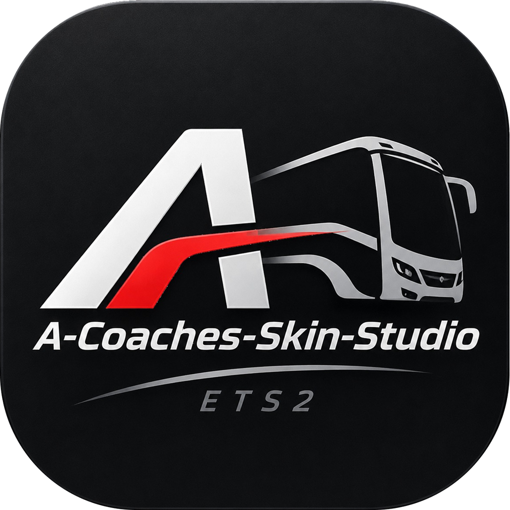

# Coaches Skin Studio

โปรแกรมออกแบบและพรีวิวลายรถบัส ETS2 Coaches พร้อมโมเดล เทมเพลต และเครื่องมือแปลงภาพในตัว

ดาวน์โหลด **Windows x64 ZIP** จาก [Releases](https://github.com/tys0n-tech/A-Coaches-Skin-Studio/releases) แตกไฟล์ทั้งโฟลเดอร์ แล้วเปิด **Coaches Skin Studio.exe**

## เริ่มทำลายรถ

1. **เลือกรถ** และรุ่นย่อย โมเดลพร้อมใช้มี Scania Touring 12.9 / 13.7 ม., MAN Lion’s Coach 12.1 / 13.9 ม. และ Volvo 9700 DD 14.3 ม.
2. กด **บันทึกเทมเพลตรุ่นนี้** นำ PNG 4096 × 2048 ไปวางใน Figma หรือโปรแกรมวาดภาพ วาดลายบนเลเยอร์ใหม่แล้วซ่อนผังก่อน Export
3. กด **เพิ่มลายรถ** เลือก PNG ที่ออกแบบไว้ แก้ไฟล์และ Save เพื่อรีโหลดอัตโนมัติ ใช้ปุ่มมุมซ้าย ขวา หน้า และท้ายตรวจตำแหน่งกับรอยต่อ
4. กด **Export .scs** แล้ววางไฟล์ใน `Documents/Euro Truck Simulator 2/mod` เปิด Mod Manager จากนั้นเลือกลายในอู่แต่งรถ รุ่นรถและขนาด PNG จะถูกตรวจตอนส่งออก

ใช้พรีวิวตรวจตำแหน่งและรอยต่อของลาย แล้วตรวจสี แสง และวัสดุจริงอีกครั้งในเกม

## กระจกข้างครบทั้ง 5 รุ่น

แต่ละรุ่นมีผังกระจกตรงกับโมเดล รวมกระจกสองชั้น Volvo โปรแกรมจะแสดงเครื่องมือลายกระจกข้าง เปิด **ใช้ลาย PNG ตัวถังต่อขึ้นกระจก** เพื่อพรีวิวและส่งออกรวมกับตัวถัง

ถ้าทำกระจกแยก กด **บันทึกผังซ้อนตัวถัง** วางผังที่ X = 0, Y = 0 ในเฟรม 4096 × 2048 ซ่อนผังก่อน Export เฟรมเต็มเป็น PNG โปร่งใส แล้วนำเข้าผ่าน **เพิ่มลายกระจก**

โปรแกรมสร้างภาพกระจกเฟรมเต็ม 4096 × 2048 รองรับ PNG และ DDS เฟรมเต็ม สำหรับ Scania 13.7 ม. ยังอ่านผังกระจกเดิม 4096 × 1024 และ 2048 × 512 ได้ ลายกระจกใช้ช่องสติกเกอร์เตือนของรถ โปรดทดสอบการเปลี่ยนลายและการถอดมอดกับเซฟของคุณ

## แก้แพ็กเดิม

เปิด **แก้แพ็ก .scs เดิมและตั้งค่าเครื่องมือเอง** เลือกแพ็กแบบ ZIP และไฟล์ DDS ที่ต้องการแทนที่ กด **กลับไปสร้างลายใหม่** เพื่อใช้การส่งออกอัตโนมัติอีกครั้ง

## เปิดจากซอร์ส

ติดตั้ง Node.js 22.12 ขึ้นไป แล้วเปิด `RUN_WINDOWS.bat` หรือรัน `npm ci`, `npm test` และ `npm run build`

รัน `npm run dist:win` เพื่อแพ็กสำหรับ Windows โฟลเดอร์ `resources/` รวมในไฟล์ดาวน์โหลดผ่านการตั้งค่า extraResources และโหลดอัตโนมัติเมื่อเปิดโปรแกรม

ตัวโปรแกรม Windows ใช้ไฟล์ในเครื่องและยังไม่มีลายเซ็นดิจิทัล ไฟล์ SHA-256 ใน Release ใช้ตรวจความตรงกันของไฟล์ดาวน์โหลด

## v0.4.0

- พรีวิว บันทึกผัง และส่งออกลายกระจกข้างได้ครบทั้ง 5 รุ่น รวม Volvo สองชั้น
- ใช้ผังกระจกเฟรมเต็ม 4096 × 2048 ต่อเนื่องกับตัวถัง
- แสดงสถานะโหลดแทนโมเดลกล่องขณะเปลี่ยนรถ และแสดงเฉพาะรุ่นที่เลือกล่าสุด
- เพิ่มปุ่มโหลดอีกครั้งเมื่อไม่พบหรือเปิดโมเดลไม่สำเร็จ

## v0.4.1

เพิ่มโลโก้ A-Coaches Skin Studio ที่ให้มาเป็นไอคอนโปรแกรม Windows ไอคอนหน้าต่าง และโลโก้ในโปรแกรม

## v0.4.2 — แก้ไฟล์มอดส่งออกไม่ทำงาน

แก้ชื่อภายในไฟล์ .scs ที่ยาวเกินขีดจำกัดของ ETS2 ทำให้เกมไม่โหลดลายตัวถังและกระจก ใช้ v0.4.2 ส่งออกใหม่แล้วแทนไฟล์ .scs เดิม การอัปเดตโปรแกรมอย่างเดียวไม่แก้ไฟล์ที่ส่งออกไว้แล้ว
